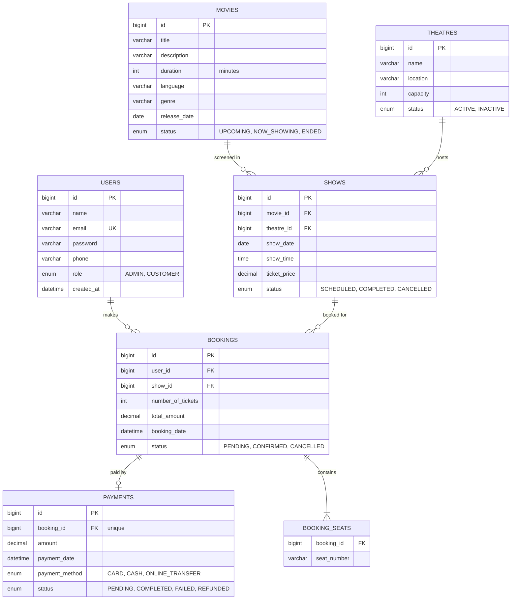

# Movie Ticket Booking System — Backend

CMJD 114/115 · Assignment 1 · Backend Development with Spring Boot and MySQL

A REST API for an online movie ticket booking platform. Customers browse movies, theatres and shows, check seat availability, book seats and pay. Administrators manage users, movies, theatres, shows, bookings and payments. Authentication and authorization use Spring Security with JWT.

## Technologies used

- Java 17, Spring Boot 3.3
- Spring Web, Spring Data JPA (Hibernate), Spring Validation
- Spring Security with JWT (jjwt 0.12)
- MySQL 8
- Maven, Lombok, SLF4J/Logback
- Git & GitHub

## Project structure (layered architecture)

```
src/main/java/lk/ijse/movieticket
├── config/          DataInitializer (creates the default admin)
├── controller/      REST controllers (Auth, User, Movie, Theatre, Show, Booking, Payment)
├── dto/             Request / response DTOs with validation annotations
├── entity/          JPA entities (User, Movie, Theatre, Show, Booking, Payment)
├── enums/           Role and status enums
├── exception/       Custom exceptions + GlobalExceptionHandler
├── repository/      Spring Data JPA repositories
├── security/        JwtUtil, JwtAuthenticationFilter, UserDetailsService, SecurityConfig
└── service/         Business logic and business rules
```

Request flow: **Controller → Service → Repository → Database**

## Database configuration

1. Install MySQL 8 and make sure it is running on `localhost:3306`.
2. Update the credentials in `src/main/resources/application.properties`:

```properties
spring.datasource.url=jdbc:mysql://localhost:3306/movie_ticket_db?createDatabaseIfNotExist=true&useSSL=false&allowPublicKeyRetrieval=true&serverTimezone=Asia/Colombo
spring.datasource.username=root
spring.datasource.password=1234
spring.jpa.hibernate.ddl-auto=update
```

The database `movie_ticket_db` and all tables are created automatically on first run.

## Entity relationship diagram



Relationships: User 1:M Booking · Booking M:1 Show · Booking 1:1 Payment · Show M:1 Movie · Show M:1 Theatre.
Seat numbers are stored with the booking (`booking_seats` is the element-collection table of the Booking entity, not a separate entity).

**Seat numbering:** seats are derived from the theatre capacity — rows `A`, `B`, `C` … with 10 seats each (`A1`…`A10`, `B1`…`B10`, …). A capacity of 45 gives `A1`–`D10` and `E1`–`E5`. Maximum capacity is 260 (rows A–Z).

## Authentication instructions

1. **Sign up** (`POST /api/auth/signup`) — always creates a `CUSTOMER` account.
2. **Sign in** (`POST /api/auth/signin`) — returns a JWT token.
3. Send the token with every protected request:

```
Authorization: Bearer <token>
```

Tokens expire after 24 hours (`app.jwt.expiration-ms`).

**Default admin:** on first start the application creates an admin account (configurable in `application.properties`):

| Email | Password |
|---|---|
| `admin@cinema.lk` | `admin123` |

Change these credentials and `app.jwt.secret` before any real deployment.

## API endpoints

Access: **Public** = no token · **Auth** = any signed-in user · **Owner** = the customer who owns the resource.

### Authentication
| Method | Endpoint | Access | Description |
|---|---|---|---|
| POST | `/api/auth/signup` | Public | Register a customer |
| POST | `/api/auth/signin` | Public | Sign in, returns JWT |

### Users
| Method | Endpoint | Access | Description |
|---|---|---|---|
| GET | `/api/users` | ADMIN | Get users |
| GET | `/api/users/{id}` | ADMIN / self | Get user by ID |
| PUT | `/api/users/{id}` | ADMIN / self | Update user (only ADMIN can change roles) |
| DELETE | `/api/users/{id}` | ADMIN | Delete user |

### Movies
| Method | Endpoint | Access | Description |
|---|---|---|---|
| POST | `/api/movies` | ADMIN | Create movie |
| GET | `/api/movies` | Public | Get movies |
| GET | `/api/movies/{id}` | Public | Get movie by ID |
| PUT | `/api/movies/{id}` | ADMIN | Update movie |
| DELETE | `/api/movies/{id}` | ADMIN | Delete movie |

### Theatres
| Method | Endpoint | Access | Description |
|---|---|---|---|
| POST | `/api/theatres` | ADMIN | Create theatre |
| GET | `/api/theatres` | Public | Get theatres |
| GET | `/api/theatres/{id}` | Public | Get theatre by ID |
| PUT | `/api/theatres/{id}` | ADMIN | Update theatre |
| DELETE | `/api/theatres/{id}` | ADMIN | Delete theatre |

### Shows
| Method | Endpoint | Access | Description |
|---|---|---|---|
| POST | `/api/shows` | ADMIN | Create show |
| GET | `/api/shows` | Public | Get shows |
| GET | `/api/shows/{id}` | Public | Get show by ID |
| GET | `/api/shows/movie/{movieId}` | Public | Get shows for a movie |
| GET | `/api/shows/{id}/seats` | Public | Seat availability for a show |
| PUT | `/api/shows/{id}` | ADMIN | Update show |
| DELETE | `/api/shows/{id}` | ADMIN | Delete show |

### Bookings
| Method | Endpoint | Access | Description |
|---|---|---|---|
| POST | `/api/bookings` | CUSTOMER | Create booking |
| GET | `/api/bookings` | ADMIN | View all bookings |
| GET | `/api/bookings/my-bookings` | CUSTOMER | Get the customer's bookings |
| GET | `/api/bookings/{id}` | ADMIN / Owner | Get booking by ID |
| PUT | `/api/bookings/{id}/cancel` | CUSTOMER (Owner) | Cancel booking |
| PUT | `/api/bookings/{id}/status` | ADMIN | Update booking status |

### Payments
| Method | Endpoint | Access | Description |
|---|---|---|---|
| POST | `/api/payments` | CUSTOMER (Owner) | Create payment for a booking |
| PUT | `/api/payments/{id}/process` | CUSTOMER (Owner) | Process payment |
| GET | `/api/payments` | ADMIN | View payment information |
| GET | `/api/payments/{id}` | ADMIN / Owner | Get payment details |
| GET | `/api/payments/{id}/status` | ADMIN / Owner | Check payment status |

**Payment processing:** a real payment gateway is outside the core scope, so the gateway result is simulated with `{"success": true | false}`.

## Business rules implemented

- **Movies:** only ADMIN can create/update/delete; customers can view; `ENDED` movies cannot get new shows.
- **Theatres:** only ADMIN can manage; shows can only be created for an `ACTIVE` theatre.
- **Shows:** must reference an existing movie and theatre; `CANCELLED` and `COMPLETED` shows reject bookings; the same theatre cannot have two non-cancelled shows at the same date and time.
- **Bookings:** only authenticated customers can book; at least one seat; `numberOfTickets` must equal the number of seat numbers; already-booked seats are rejected (cancelled bookings release their seats); `totalAmount = ticketPrice × numberOfTickets`; cancelled bookings cannot be paid.
- **Payments:** must belong to a booking; a `COMPLETED` payment confirms the booking; a `FAILED` payment leaves the booking `PENDING` (the customer may retry); a completed payment cannot be processed again. Cancelling a paid booking marks its payment `REFUNDED`.
- Deleting a movie/theatre with shows, a show with bookings, or a user with bookings is rejected with `409 Conflict` (use the status field instead).

## Error handling & status codes

All errors return a consistent JSON body from `GlobalExceptionHandler`:

```json
{
  "timestamp": "2026-10-01T10:15:30",
  "status": 400,
  "error": "Bad Request",
  "message": "Validation failed",
  "path": "/api/bookings",
  "validationErrors": { "seatNumbers": "At least one seat must be selected" }
}
```

| Code | When |
|---|---|
| 200 / 201 / 204 | Success / created / deleted |
| 400 | Validation or business-rule failure |
| 401 | Missing/invalid token or wrong credentials |
| 403 | Signed in but not allowed |
| 404 | Resource not found |
| 409 | Duplicate email, seat already booked, show clash, delete conflicts, already paid |
| 500 | Unexpected error (logged) |

## Logging

SLF4J logs important activity (registrations, sign-ins, CRUD operations, bookings, payments, refunds, failures) to the console and to `logs/movie-ticket-booking.log`.

## Sample API requests

**Sign up**
```http
POST /api/auth/signup
Content-Type: application/json

{ "name": "Nimal Perera", "email": "nimal@example.com", "password": "secret123", "phone": "0771234567" }
```

**Sign in** → response contains the token
```http
POST /api/auth/signin
Content-Type: application/json

{ "email": "admin@cinema.lk", "password": "admin123" }
```
```json
{ "token": "eyJhbGciOi...", "tokenType": "Bearer", "userId": 1, "name": "System Admin", "email": "admin@cinema.lk", "role": "ADMIN" }
```

**Create movie** (ADMIN)
```http
POST /api/movies
Authorization: Bearer <admin-token>
Content-Type: application/json

{ "title": "Interstellar", "description": "A team travels through a wormhole.", "duration": 169,
  "language": "English", "genre": "Sci-Fi", "releaseDate": "2014-11-07", "status": "NOW_SHOWING" }
```

**Create theatre** (ADMIN)
```http
POST /api/theatres
Authorization: Bearer <admin-token>
Content-Type: application/json

{ "name": "Scope Cinemas", "location": "Colombo 03", "capacity": 80, "status": "ACTIVE" }
```

**Create show** (ADMIN)
```http
POST /api/shows
Authorization: Bearer <admin-token>
Content-Type: application/json

{ "movieId": 1, "theatreId": 1, "showDate": "2026-10-15", "showTime": "18:30", "ticketPrice": 1500.00 }
```

**Seat availability**
```http
GET /api/shows/1/seats
```

**Create booking** (CUSTOMER)
```http
POST /api/bookings
Authorization: Bearer <customer-token>
Content-Type: application/json

{ "showId": 1, "seatNumbers": ["A1", "A2", "A3"], "numberOfTickets": 3 }
```

**Create and process payment** (CUSTOMER)
```http
POST /api/payments
Authorization: Bearer <customer-token>
Content-Type: application/json

{ "bookingId": 1, "paymentMethod": "CARD" }
```
```http
PUT /api/payments/1/process
Authorization: Bearer <customer-token>
Content-Type: application/json

{ "success": true }
```

**Cancel booking** (CUSTOMER)
```http
PUT /api/bookings/1/cancel
Authorization: Bearer <customer-token>
```

**Update booking status** (ADMIN)
```http
PUT /api/bookings/1/status
Authorization: Bearer <admin-token>
Content-Type: application/json

{ "status": "CANCELLED" }
```

## How to run the project

Prerequisites: JDK 17+, Maven 3.9+, MySQL 8.

```bash
git clone <your-repository-url>
cd movie-ticket-booking-backend
# update DB credentials in src/main/resources/application.properties
mvn clean install
mvn spring-boot:run
```

The API runs at `http://localhost:8080`. CORS is enabled for the React frontend at `http://localhost:5173` (`app.cors.allowed-origins`).

## Future expansion — proposal

### 1. Movie reviews and ratings
- **Feature:** customers who attended a show rate a movie (1–5) and write a short review; movie pages show the average rating.
- **Why useful:** helps other customers choose movies and gives admins feedback on what to screen.
- **Affected entities:** `Movie` (gets an average rating / review list), `User` (writes reviews).
- **New entity:** `Review` (id, rating, comment, createdAt).
- **Relationships:** `User 1:M Review`, `Movie 1:M Review`, with a unique constraint on (user_id, movie_id) so each customer reviews a movie once. Eligibility can be checked through `Booking` (a confirmed booking for a completed show of that movie).

### 2. Multiple-screen support with a seat layout
- **Feature:** a theatre has several screens, each with its own seat map (rows, seat types such as standard/premium, and per-type prices).
- **Why useful:** reflects real cinemas, allows several shows at the same time in one theatre, and supports premium pricing.
- **Affected entities:** `Theatre` (capacity moves to screens), `Show` (belongs to a screen instead of directly to a theatre), `Booking` (references seat records instead of seat strings).
- **New entities:** `Screen` (id, name, theatre), `Seat` (id, rowLabel, number, type, screen), and `BookingSeat` (booking, seat, price).
- **Relationships:** `Theatre 1:M Screen`, `Screen 1:M Seat`, `Screen 1:M Show`, `Booking 1:M BookingSeat`, `Seat 1:M BookingSeat`. The show-clash rule becomes "same screen, same date and time", and a unique constraint on (show_id, seat_id) for active bookings enforces no double-booking at the database level.


